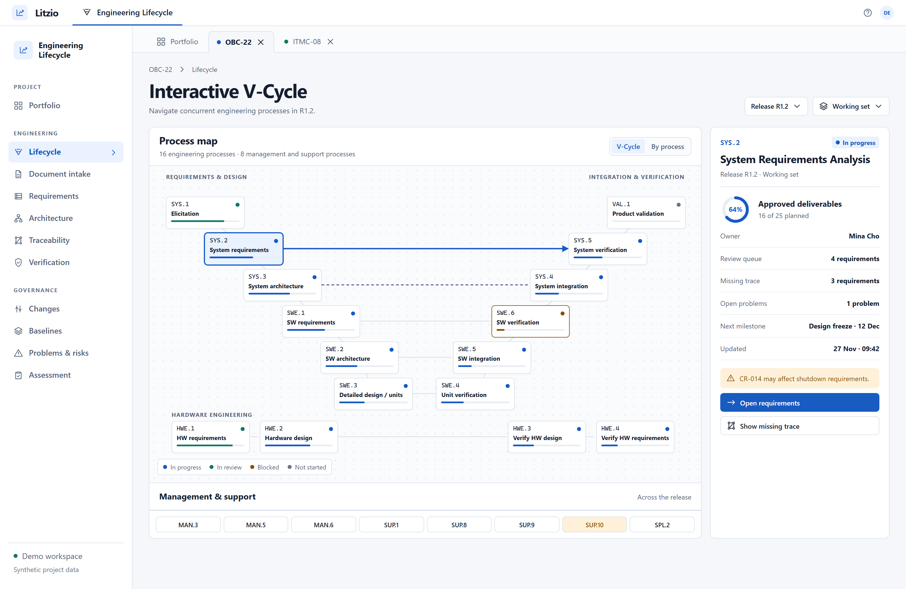
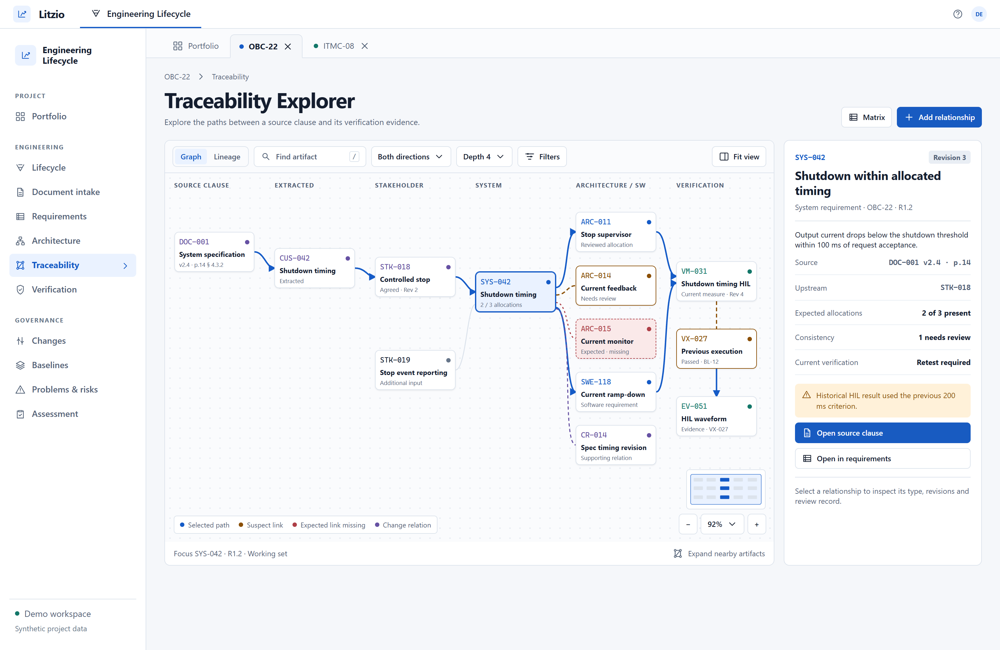

# Litzio Engineering Lifecycle 디자인 시안

Phase 1 조사와 Phase 2 디자인 검토 자료다. 아래 이미지는 가상의 OBC·열관리 컨트롤러 프로젝트를 사용해 별도 디자인 목업으로 렌더링했다. 예시 수치의 산정 기준, SDK 지원 범위와 구현 후 검증 기준은 [Phase 1 조사 및 설계](technical-plan.md)에 있다. [8분 시연 스크립트](demo-script.md)는 시안 순서와 검증할 상태 전환을 연결한다.

## 선택을 권장하는 디자인

- **V-Cycle A를 기본으로 제안한다.** 시스템·소프트웨어·하드웨어 작업과 검증의 대응 관계가 시연 중 한눈에 들어온다. B의 도메인 행은 프로세스 목록 보기로 활용할 수 있다. 두 안에서 릴리즈와 Baseline이 작업 범위를 정하며, 선택한 프로세스는 우측 요약에서 업무 화면으로 이어진다.
- **Traceability Explorer A를 기본으로 제안한다.** 선택한 요구사항에 여러 근거가 들어오고 여러 설계·검증 대상으로 전개되는 관계를 선으로 읽을 수 있다. B는 같은 링크 데이터를 업무 검토에 적합한 다열 Lineage로 보여준다. B 하단의 흐름도는 릴리즈 집계이며 각 항목의 경로 확인은 위쪽 열 또는 그래프에서 한다.

### V-Cycle A · 프로세스 맵

### Traceability Explorer A · 관계 그래프

## 전체 시안과 주요 인터랙션

각 이미지 원본은 3200×2080 px이다. 라이트·다크는 같은 제품의 테마이며 안별 비교 링크는 라이트 버전을 가리킨다. 화면에 표시된 조작은 승인 이후 구현할 설계다.

| 화면 | 원본 이미지 | 디자인 및 주요 인터랙션 |
| --- | --- | --- |
| Project Portfolio | [01](01-project-portfolio.png) | 개발 중인 OBC와 릴리즈 준비 중인 열관리 컨트롤러를 나란히 비교한다. 소형 V-Cycle로 진행 중인 영역을 찾고, 프로젝트를 열면 플러그인 내부 프로젝트 탭에서 해당 릴리즈와 필터를 유지한다. 카드의 분수는 진행률·커버리지 분모를 표시한다. Workspace data에서 편집용 데이터 팩을 만들거나 다시 연다. |
| Interactive V-Cycle A | [02](02-v-cycle-a.png) | V형 배치 안에서 설계와 검증을 연결하고, 관리·지원 프로세스는 하단에 한 줄로 묶는다. 노드나 하단 항목을 선택하면 담당자·진행·Gap을 확인한 뒤 해당 업무 화면으로 이동한다. 선은 제품의 탐색용 대응 관계를 나타낸다. |
| Interactive V-Cycle B | [03 다크](03-v-cycle-b.png) · [12 라이트](12-v-cycle-b-light.png) | 시스템·SW·HW·검증을 행으로 고정하고 요구사항과 설계, 우측의 검증 작업을 비교한다. 여러 프로세스의 병행 활동과 검토 대기를 확인하고, 셀을 선택해 같은 상세 패널을 연다. |
| Customer document review | [04](04-document-intake.png) | 왼쪽으로 고객 문서를 고르고 가운데에서 원문 페이지를 본다. 오른쪽 CUS-042를 누르면 v2.4의 p.14 §4.3.2가 강조된다. 추출 제안을 검토에 수락하거나 Clarification을 만들며 승인 기록은 별도로 남긴다. |
| Requirement Engineering Workspace | [05](05-requirement-engineering.png) | 고밀도 표와 우측 상세를 동시에 사용한다. SYS-042에서 버전을 비교하고, 여러 행을 선택해 속성을 바꾸며, 근거·검증 기준과 누락된 할당을 확인한다. |
| Traceability Explorer A | [06](06-traceability-explorer-a.png) | SYS-042 주변에 문서 조항, 고객·Stakeholder 요구사항, 두 설계 할당과 검증 근거를 점진적으로 펼친다. 선 선택으로 관계 유형과 검토 상태를 읽고, 노드 선택이나 방향 전환으로 원문과 증거를 양방향 탐색한다. 점선·경고·아이콘으로 검토 필요와 연결 누락을 구분한다. |
| Traceability Explorer B | [07 다크](07-traceability-explorer-b.png) · [13 라이트](13-traceability-explorer-b-light.png) | 객체 유형별 검색과 접기를 제공한다. 선택 항목의 연결만 강조하고 선택된 경로를 상단에 표시한다. 하단 집계 흐름 밴드는 조건에 맞는 항목으로 필터링한다. |
| Traceability Matrix | [08](08-traceability-matrix.png) | SYS-042 × ARC-015 셀의 누락 원인을 열고 할당 관계를 추가한다. Reviewed·Suspect·Linked·Missing·Not Applicable을 기호와 설명으로 구분한다. 열 선택과 릴리즈 변경이 같은 관계 원장을 조회한다. |
| Change Impact Analysis | [09](09-change-impact.png) | 두 원문 버전의 차이를 강조하고 직접·간접 영향 후보를 펼친다. 담당자를 지정하고 각 후보의 영향 여부를 기록한다. 과거 VX-027의 합격 결과에서 당시 판정 기준과 Baseline을 확인한다. |
| Assessment Readiness | [10](10-assessment-readiness.png) | 프로세스별 산출물·증거·추적성·정합성·품질을 비교한다. 취약한 셀에서 증거를 열고 개선 조치를 만든다. L1~3은 준비할 증거 유형을 탐색하는 필터이고 평가자 의견은 별도 필드다. |
| Verification & Evidence | [11](11-verification-evidence.png) | 검증 사양·실행·증거 탭을 오가며 당시 합격 기준, 실제 108 ms, 문서·파형 EV-051을 확인한다. 새 실행을 등록하거나 요구사항과 최초 고객 문서로 역추적한다. |
| Problems, risk & quality (추가) | [14](14-risk-quality.png) | 가능성과 영향도로 위험을 배치한다. 셀에서 위험을 고르고 영향을 받는 요구사항·검증·변경 요청을 확인한다. 대응 조치와 목표 잔여 위험을 별도로 기록한다. |

## 화면 계약과 접근성

시안의 상단 탭 하나가 리치오 화면에 해당하고 그 아래 Portfolio·OBC-22·ITMC-08은 플러그인 내부 탭이다. 구현에서는 Litzio 공용 화면 제목·도구 줄·버튼·선택·표·알림과 테마 토큰을 적용한다. 표시용 식별자, 본문, 원본 문서는 서로 다른 타이포그래피 역할을 사용한다. 이미지의 UI 표기는 공식 영문 프로세스와 ALM 용어를 기준으로 했다.

선택·차단·실패·누락을 색과 문자로 함께 표시한다. 키보드로 탭, 표 셀, 그래프 노드와 링크를 탐색할 수 있게 하고 그래프와 같은 정보를 구조화된 목록에서도 조회할 수 있게 한다. 작은 화면에서는 문서 대조와 상세 패널을 차례로 표시하며 행·열이 필요한 매트릭스는 내부에서 스크롤한다. 로딩 중에는 이전 범위를 식별할 수 있는 상태 표시 또는 Skeleton을 사용한다. 빈 결과에는 범위 및 필터를 조정하는 조작을 표시하며 Reduced Motion 설정에서는 애니메이션 없이 갱신한다.

## 승인 및 구현

승인된 기본안은 **V-Cycle A + Traceability Explorer A**이며, B는 업무용 보조 보기로 제공한다. 공식 SDK의 단일 네이티브 화면 안에 프로젝트별 탭이 있으며 편집 자료는 사용자가 고른 Host 작업 폴더에 저장한다. [실제 화면과 검증 결과](implementation.md)
