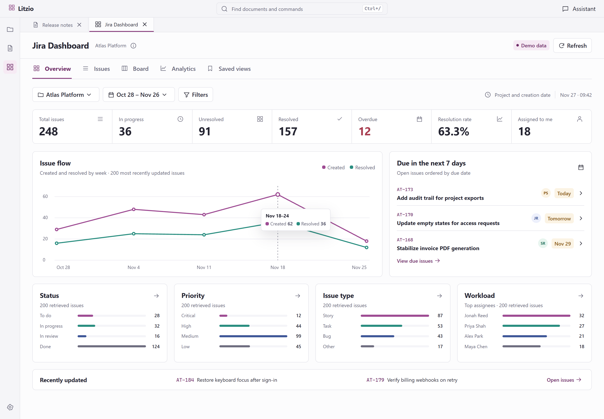
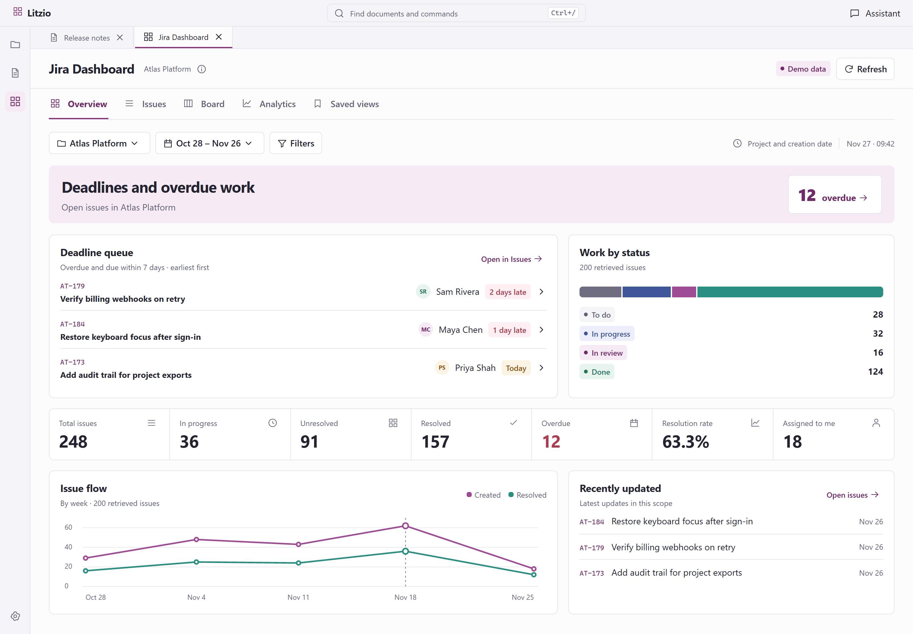

# Jira Dashboard 디자인 승인안

합성 프로젝트 Atlas Platform을 사용한 **2880 × 2000 PNG 시안 8장**이다. 리치오 작업 막대, 플러그인 탭, 설정 창을 포함한 제품 화면을 독립적으로 렌더링했다. 화면의 데이터와 연결 상태는 디자인 검토용이다. SDK 조사와 호출 예산은 [기술 검토](technical-review.md)에 있다.

## 대시보드 방향

### A안 · 프로젝트 현황과 추이 (권장)

프로젝트와 기간을 고른 뒤 KPI, 주간 생성·해결 추이, 임박한 이슈를 한 화면에서 본다. 기한 초과 수를 누르면 해당 이슈 검색으로, 담당자 막대를 누르면 담당자 필터가 적용된 검색으로 이동한다. 차트 날짜에 포인터나 키보드 포커스를 두면 수치가 보인다. 전체 조건의 KPI와 제한된 조회분으로 계산한 차트에 각각 범위를 표시한다. 주간 업무 리뷰와 당일 우선순위 확인을 한 화면에서 할 수 있어 플래그십 기본 화면으로 권장한다. [어두운 테마](08-overview-a-dark.png)

### B안 · 기한 중심 업무 검토

업무 시작 시 밀린 이슈부터 처리할 수 있도록 기한 초과 건수와 기한순 목록을 위에 배치한다. 목록에서 이슈를 바로 열고 상태 분포는 인접한 막대와 범례에서 비교한다. KPI와 주간 추이는 그 아래에 이어진다. 우선순위, 이슈 유형, 담당자별 분포는 Analytics에서 본다.

## A안을 기준으로 한 작업 화면

| 화면 | 디자인 의도와 주요 인터랙션 |
| --- | --- |
| [이슈 검색 및 테이블](03-issues.png) | 검색어, 기본 필터, 고급 JQL을 한 조작 영역에 둔다. Chip을 누르거나 삭제해 필터를 수정한다. ‘Show JQL’에서 생성식을 보고, 고급 모드에서 편집·실행하고 오류 위치를 확인한다. 최근 검색과 저장은 같은 줄에 둔다. 열 설정에서 프로젝트·보고자·생성일 등을 켜고, 열 경계를 드래그하거나 키보드로 너비를 조절한다. 행 선택과 상세 열기, 원본 Jira 링크는 각각 독립된다. |
| [칸반 보드](04-board.png) | 같은 검색 조건을 공유하고 결과를 Jira 상태별로 묶는다. 이미지에는 사용자가 최근 수정 7일로 좁힌 예시를 담았다. 열마다 조회된 건수와 표시 중인 건수를 보여 준다. 아래 더 보기로 같은 열의 카드를 펼치고, 카드 선택은 상세 패널을 연다. |
| [이슈 상세 패널](05-issue-detail.png) | 선택 행과 검색 맥락을 왼쪽에 유지한다. 오른쪽에서 요약과 관계를 읽고 댓글·첨부·변경 이력 탭을 열 때 해당 데이터를 가져온다. 닫으면 원래 행으로 포커스를 돌려준다. 좁은 화면에서는 전체 폭 상세와 목록 복귀를 사용한다. |
| [사용자 자동완성 및 필터](06-user-picker.png) | 표시 이름 아래 로그인 식별자를 표시해 동명이인을 구분한다. 선택된 사용자는 체크와 Chip으로 표시한다. 두 글자부터 검색하고 로딩·결과 없음·권한 오류를 메뉴 안에 표시한다. 화살표로 이동하고 Enter로 선택하며 Esc로 닫는다. 보고자도 같은 조작을 사용한다. |
| [플러그인 설정](07-settings.png) | 리치오의 플러그인 설정에서 Base URL, 토큰 상태, 연결 확인을 순서대로 배치한다. 저장된 PAT는 설정 여부로 표시하며 입력할 때 마스킹한다. 연결 테스트 결과는 현재 사용자와 함께 표시한다. 계정 이름의 배치는 Host가 지원하는 상태 메시지 범위에 맞춘다. |
| [A안 어두운 테마](08-overview-a-dark.png) | 호스트 테마에 따라 표면·텍스트·강조 색을 바꾸고 상태와 차트는 텍스트를 함께 표시한다. |

라이브 화면에서는 Host의 단일 화면 제목과 공용 버튼·상태·메뉴를 사용한다. 차트의 숫자는 포커스로 읽을 수 있게 하고, 로딩 중에는 영역 높이를 유지한다. 새로 고침에 실패하면 마지막 조회 시각을 표시한다. `/`는 이슈 검색에 포커스를 보내며 입력 중에는 원래 키를 유지한다. Reduced Motion에서는 숫자나 패널을 즉시 갱신한다.

## 승인 범위

A안과 위 작업 화면을 승인받아 구현했다. 현재 화면과 검증 범위는 [구현 기록](implementation.md)에 있다.
