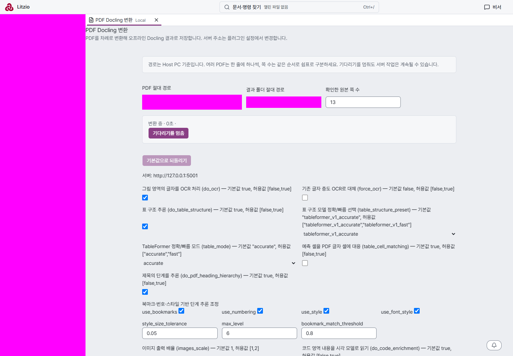

# docling-convert

PDF를 Docling 변환 서버로 보내 [변환 계약](../../contracts/docling-convert/README.md)의 결과 묶음을 받아 저장한다.

## 출처

이 폴더의 `host.mjs`, `screen.jsx`, `litzio-plugin.json`, `options.json`, `pdf-en-v2.json`은 리치오의 비서가 만든 것을 **고치지 않고 그대로** 넣은 것이다(2026-11-13, 비서의 플러그인 제작 시험의 과제 3: 변환 계약을 통째로 주고 만들게 함). 시험의 경위와 판정은 리치오 저장소의 `docs/reviews/plugin-screen-code-1592.md` "3단계" 절에 있다.

시험에서 확인된 상태:

- 첫 턴에는 완성하지 못했다. 한 번의 호출로 변환이 끝날 때까지 기다리게 만들었다가 호출 시간 제한에 걸렸고, 비서가 접수와 상태 조회로 나누는 구조로 고친 뒤 실제 서버에서 변환과 저장이 됐다(13쪽 표본, 약 46초).
- 계약의 일부가 빠져 있다(결과 이미지의 검증 등). 완전한 성공으로 판정하지 않았다.

계약에 맞춰 보완한 내용은 이 문서 아래에 날짜와 함께 구분해 적는다. 비서가 만든 원본은 이 커밋에 그대로 남아 있다.

## 보완 — 2026-11-13

원본은 커밋 `4791ca4`에 보존된다. 이번 변경은 기존 multipart → 접수 → poll → 결과 수령 구조와 옵션 정의를 유지한다. Host 진입점은 공개 제작 검사가 요구하는 리터럴 handler를 유지하고 `service.mjs`에 위임한다. `validation.mjs`는 서버 계약과 PNG 디코딩을 검사한다. 새 런타임 의존성은 없다.

### 계약 대조표 (원본 → 보완)

판정은 소스의 구현 여부이며 실제 검증 범위는 아래에 따로 적었다. 원본 근거는 `4791ca4:plugins/docling-convert/host.mjs`의 함수/식이다. 보완 근거는 이 폴더의 파일이다.

| 요구 | 원본 판정·근거 | 보완 판정·근거 |
| --- | --- | --- |
| 준비 확인 순서 | 부분: runConversion이 ready/version/OpenAPI/capabilities 수령만 함 | 충족: service.runConversion 순서 유지, validation.validateServer가 1.38.2·multipart 필드·preset 확인 |
| 한 PDF, MIME/basename, form 필드 형식 | 충족: FormData files, 배열 반복/객체 JSON/boolean 문자열 | 충족: 같은 조립 코드 유지, 가짜 HTTP에서 본문 검사 |
| 접수 즉시 응답, ID 인코딩, 1초 poll, result 수령 | 충족: convert/job와 encodeURIComponent | 충족: service.convert의 직렬 대기열, 동일 HTTP 흐름 |
| task/result success 및 errors=[] | 누락: complete=false 고정, 완전 성공 조건 없음 | 충족: decideComplete의 명시적 성공 증거와 schema 검증 |
| 모든 쪽 존재 | 부분: allPages 계산하지만 성공 판정에 사용 안 함 | 충족: validateResult가 정확한 수·연속 키·page_no 확인 |
| 이미지 오프라인 해석 | 누락: URI 정규식만, image_decode_verified=false | 충족(지원 PNG 범위): PNG signature/CRC/zlib/scanline/filter 역변환; 다른 인코딩은 성공 거부 |
| 부분 성공·실패 기록 | 부분: HTTP 실패 기록, 입력 검증 실패는 작업 error만 | 충족: 후보 생성 뒤 옵션·원본 검증도 catch해 record에 진단; incomplete 이유 표시 |
| 1800초 전체 제한·HTTP 남은 시간 | 부분: timeout만 연결, dispose/화면 중단 없음 | 충족: 남은 시간 timeout과 AbortController 연결, stop/dispose가 로컬 대기 중단 |
| 중단은 서버 취소가 아님·uncertain 재전송 금지 | 부분: uncertain/recover 있으나 중단 UI 없음 | 충족: 명시 문구, 중단/불확실 실패 뒤 다음 제출 보류 |
| source.pdf/document.json/record 파일 | 충족: 후보에 3파일 | 충족: 같은 구성, 다음 플러그인 명령으로 검증 |
| 입력 basename/상대경로/bytes/digest | 충족: record.source | 충족: source.file=source.pdf 유지 |
| 프로필 전체/ID/hash·서버 package 버전·OpenAPI digest | 충족: record.profile/server/openapi_sha256 | 충족: 같은 필드, 실행 bytes hash와 LF profile hash 분리 |
| 실제 요청 전체·기본값 차이 | 충족: actual_request/overrides_from_default | 충족: 동일, 옵션 변경 실제 서버 확인 |
| task/status·UTC·elapsed·result body digest | 충족: record.task_id/task_status/result | 충족: 원본 필드와 task 응답도 함께 보관(고정 표본·소비자 호환) |
| document digest/schema/version/page_count | 충족: record.document | 충족: 그대로 유지 |
| 후보 완성 뒤 공개·덮어쓰기 금지 | 부분: rename 경로 있지만 complete=false라 도달 불가 | 충족: complete만 UUID 새 이름에 rename, 기존 결과 보존; OS rename 실패는 실패로 노출 |
| 조정값/고정값·타입·허용값·의존성 | 부분: 기본 검증 있으나 비활성 세부 옵션 조정 허용 | 충족: fixed/unknown 거부, 제목 범위, OCR·표 의존성, preset/mode 일치 검사 |
| 옵션 정의와 프로필 사본 일치 | 누락: 검사 없음 | 충족: test/service.test.mjs byte 대조 |
| 기본값 복원·옵션 설명/허용값/기본값 | 부분: 조정 UI 있으나 복원 없음 | 충족: screen.jsx, 고정값 별도 읽기 표시 |
| 여러 파일을 서버에 하나씩 | 누락: convert마다 동시 실행 | 충족: Promise 직렬 queue; 파일 경로/쪽 수를 같은 순서로 입력 |
| 진행·경과·완료 위치·재개방 | 부분: 화면 로컬 job ID에 의존 | 충족: Host 처리 모듈의 job 목록을 화면 mount부터 조회 |
| 공개 읽기 작업·비서 지침 | 부분: defaults/recover만 공개, 스킬 없음 | 충족: 공개 job, skills/convert/SKILL.md 등록 |

### 선택한 동작

옵션은 변환마다 기본 프로필을 복사하고 overrides를 적용한다. 설정의 전역 기본값을 바꾸지 않는다. 표 preset과 mode는 화면에서 함께 바뀐다. 잘못된 조합은 서버 제출 전에 거부한다. 실패 시 프로필 자동 하향·자동 재제출은 없다. 서버는 설정 `serverUrl`에서 받는다.

여러 PDF 경로는 한 줄에 하나, 확인한 쪽 수는 쉼표 구분이다. 공개 화면 계약에 열린 폴더/파일 목록을 받는 호출이 없어 경로 입력을 선택했다. 서버 취소 API는 없으며 기다리기를 멈추면 서버 작업이 계속될 수 있다. 이때 대기 중인 후속 파일은 자동 제출하지 않는다. 운영자가 기존 작업 상태를 확인한 뒤 명시적으로 플러그인을 다시 불러와 새 접수를 결정한다. 화면 닫기는 작업 중단이 아니다. Host 재시작·reload는 메모리 작업 목록을 복원하지 않는다. 보존된 후보 기록으로 recover 조회를 한다.

완전 성공은 변환 계약의 기계적 성공이며 의미 동등성·검수 완료를 뜻하지 않는다. 현재 디코더는 서버 표본의 non-interlaced 8-bit grayscale/RGB/gray-alpha/RGBA PNG만 허용하고, 다른 형식·인코딩은 불완전 결과로 보존한다. 디코딩 상한은 이미지당 256 MiB다. 내장 Node zlib로 압축 해제하고 scanline filter를 복원한다.

## 설치

공개 CLI의 폴더 설치가 동작한다. 별도 격리 Host를 명시한다. SDK/앱 내부 import나 다른 플러그인 코드 import는 없다.

```sh
node BUILT_CLI plugins install PLUGIN_DIRECTORY --host HOST_ORIGIN --json
node BUILT_CLI operation invoke local.docling-convert.job --input EMPTY_JSON --host HOST_ORIGIN --json
```

Host에서 읽을 수 있는 경로여야 한다. 이번 시험은 artifact를 격리 Host의 허용 root 안에 복사한 뒤 위 명령을 실행했다. 원본 폴더가 허용 root 밖에 있을 때는 artifact 검증 실패였다. 따라서 폴더 설치 자체는 플랫폼 부족으로 기록하지 않는다. 수정 후 install을 다시 실행해야 한다. PNG 캡처/입력 파일도 artifact digest에 영향을 주므로 입력 JSON은 artifact 밖에 둔다.

공개 `convert`는 write 작업이고 비서의 공개 도구는 read만 허용한다. 화면 또는 외부 CLI가 시작하고, 비서는 `job`과 `recover`로 관찰한다. write를 read로 잘못 선언하지 않는다. 플랫폼에 필요한 능력: 열린 폴더의 파일 선택/목록, 명시적 승인 아래 비서가 공개 write 작업을 실행하는 경로.

## 검사 결과 — 2026-11-13

- **가짜 HTTP/단위**: `node --test plugins/docling-convert/test/*.test.mjs`, 16개 통과. 사본 byte 일치, 실제 고정 PNG 디코딩·손상/누락 거부, multipart 형식·옵션, 성공/부분/오류/실패/접수 연결 끊김, 기록 필드, 새 이름 결과 보존, 지연 poll 중 로컬 중단과 후속 제출 보류. 1800초 실제 대기와 전원 장애는 시험하지 않았다.
- **실제 서버**: 기존 docling-serve 1.38.2 컨테이너를 compose `up -d --no-recreate --pull never`로 시작. ID 유지, ready 200. LSR-1.1 13쪽 권장값 약 27초, table_cell_matching=false 약 22초 모두 task/result success, errors=[], 모든 쪽·15개 이미지 디코딩 통과. 기본 결과 텍스트 155개 전부 고정 결과와 동일, 표 10/그림 2/그룹 2 동일. JSON byte 동등성·모든 bbox/셀의 전수 동등성·원문 의미 동등성은 주장하지 않는다. 변경 요청 전체와 차이가 record에 남았다.
- **리치오 화면**: 공개 master `c9cb271720c6`의 임시 사본을 빌드한 격리 HTTP Host. 원본 checkout tracked 파일은 변경하지 않았다. install/validate, 경로 입력→옵션 변경→접수→진행→저장 완료, 변환 중 탭 닫고 다시 열어 상태 유지 확인. 라이트 1440×1000에서 관찰. 초기 진입점 비리터럴과 격자 체크박스 늘어남을 수정했다. reload 중 artifact 변경 오류는 재설치 뒤 재개방으로 해소했다. 실제 AI 호출/설치된 앱/사용자 daemon은 사용하지 않았다.
- **다음 플러그인**: README의 `node src/generate.js BUNDLE OUTPUT BUILT_CLI`를 명령으로 실행. 새 묶음에서 generated-draft, generationMismatches=0, diagnostics=[] 확인. 초기 record.task 누락으로 생긴 partial-conversion 진단은 task 응답 보존 후 사라졌다. 그쪽 폴더는 수정하지 않았다. 초안은 미검수다.

캡처는 계정/경로를 가렸다. 소유자의 시각 승인은 별도다.

| 옵션 | 진행 중 | 완료 |
| --- | --- | --- |
|  |  |  |

미확인: 수백 쪽/스캔/다른 언어/다른 서버 버전, 동시 외부 사용자, 비정상 종료 복구, 1800초 경계·파일시스템 fault injection, PNG 외 형식, 실제 Desktop 패키지·원격 Host·소유자 시각 승인. 원본 쪽 수는 호출자가 확인하므로 잘못된 쪽 수 입력을 독립 PDF parser로 검출하지 않는다. UUID 이름과 rename을 쓰며 악의적 동시 파일시스템 변경/전원 장애의 원자성까지 보장하지 않는다.

## 독립 리뷰 보완 — 2026-11-13

리뷰 대상 `691f5716`에서 가짜 HTTP 응답을 바꿔 `wrong-task`, `wrong-result-task`, `structure-missing` 검사를 먼저 실행했다. 세 검사 모두 예상 `failed` 대신 실제 `complete`를 받아 실패했다. 즉 기존 16개 검사는 성공 오판의 두 원인을 놓쳤다. 아래 항목은 이전 검증 기록을 대체하지 않는 추가 회귀 검증이다.

- poll은 접수 task_id와 같은 ID를 반드시 반환해야 한다. result envelope에 task_id가 있으면 같은 ID여야 한다(공개 결과 envelope에 없는 ID를 새로 필수화하지 않는다). recover도 같은 대조를 수행한다.
- 저장 전 지원 schema 이름/버전, name/origin, body/furniture, 필수 컬렉션 타입, self_ref, 부모↔자식 관계, 중복 자식/순환/미도달 항목, 모든 참조의 해석 가능성, 쪽 번호·양수 크기, provenance의 쪽·좌표 형식을 검사한다. 이것은 지원하는 최소 구조 검사이며 전체 Docling JSON Schema 검증이나 의미 동등성 검사가 아니다. 유효한 빈 body/컬렉션을 단순히 비었다는 이유로 거부하지 않는다.
- origin.filename/MIME와 원본 digest를 대조한다. Docling 2.142.1은 PDF SHA-256을 만들고 docling-core 2.104.0은 origin.binary_hash에 하위 64비트를 보존한다. [파일 hash 구현](https://github.com/docling-project/docling/blob/v2.142.1/docling/utils/utils.py), [origin uint64 변환](https://github.com/docling-project/docling-core/blob/v2.104.0/docling_core/types/doc/common/origin.py)을 대조했다. JSON.parse reviver의 원문 숫자 토큰과 JSON.rawJSON을 사용해 64비트 정수를 반올림 없이 비교·저장한다. record.source의 전체 SHA-256은 실제 송신한 PDF bytes와 보존된 사본에 결합한다. 서버 응답의 digest는 64비트이므로 전체 SHA-256의 충돌 저항성이나 악의적인 서버에 대한 인증을 주장하지 않는다. 이미 반올림된 옛 결과의 숫자를 허용하도록 기준을 낮추지 않는다.
- 구조/식별자 오류는 complete=false, state=failed로 후보 기록에 남고 완성 폴더로 공개되지 않는다. 부분 변환·이미지 불완전은 기존 계약대로 incomplete로 진단한다.
- 비차단 메모 중 제출 전 로컬 입력 오류가 후속 파일을 막는 조건만 한 줄로 좁혔다(initial/preflight는 다음 파일을 막지 않음). Host 재시작 복원, 전체 queue 실패 조합, 1800초 경계·전원 장애·한글/공백 이름·Desktop/소유자 승인은 이번 수정에서 확장하지 않았다.

### 완전 성공 조건별 거부 검사 대조

각 `reject response condition NAME` 검사는 가짜 HTTP로 조건 하나를 어긴 응답을 넣고 complete 거부, `.docling-candidate-` 보존, record.complete가 true가 아님, 오류 진단 존재를 함께 확인한다.

| 조건 | 위반 응답/검사 이름 | 판정 |
| --- | --- | --- |
| 접수 task ID 존재 | no-submit-id | uncertain, 공개 없음 |
| poll ID 존재·접수 ID와 동일 | no-poll-id, review regression wrong-task | failed |
| result ID가 제공되면 접수 ID와 동일 | review regression wrong-result-task | failed; ID가 없는 정상 envelope는 별도 성공 검사 |
| task success | fake HTTP failure, partial task cannot be promoted by a success result | failed/incomplete |
| JSON 결과 형식 | result-mime | failed |
| result success | fake HTTP partial, result-status, result-status-missing | incomplete |
| errors=[] | fake HTTP errors, errors-missing, errors-object, errors-null | incomplete |
| document/json_content 존재 | document-missing, json-content-missing, review regression structure-missing | failed |
| 입력 파일명/MIME/digest 일치 | filename, mime, digest, digest-rounded, origin-missing | failed |
| schema 이름/지원 버전 | schema, version, schema-missing, version-missing | failed |
| name/body/furniture와 자식 배열 | name, body, body-children, furniture | failed |
| 필수 컬렉션 타입 | texts, tables, pictures, groups, key-values, forms | failed |
| self_ref·참조·부모/자식·순환·중복 | reference, self-ref, parent, cycle, duplicate-child, unreachable | failed |
| 내용/표/출처 정보 타입 | text-value, table-data, provenance-type, provenance-page, bbox | failed |
| 모든 쪽과 정확한 page_no/크기 | fake HTTP missing, page-number, page-size, page-zero-size | failed |
| 쪽·그림 이미지 존재, 오프라인 디코딩 | page-image, picture-image, remote-image, fake HTTP broken, decode real fixture | failed/incomplete |
| recover의 task ID 일치 | recover refuses a status from another task | 읽기 오류, 다른 작업 상태를 반환하지 않음 |
| 결과 묶음의 필수 기록 필드/bytes 결합 | published bundle fields are derived from the exact sent and received bytes | PDF bytes/크기/전체 SHA-256, 프로필 전체/ID/두 hash, 서버 버전/OpenAPI hash, actual_request/overrides, task/status, UTC/elapsed, result status/errors/body hash, document hash/schema/version/page_count 전부 실제 bytes와 대조 |
| 완성 뒤 새 폴더로 공개 | success writes standalone bundle + 각 거부 검사 | 기존 결과 보존, 거부 후보는 공개 이름 없음 |

실제 서버는 수정 후 **한 번만** 재확인했다. 기존 컨테이너 ID를 유지하고 pull/recreate 없이 시작, 권장 프로필 LSR 13쪽이 약 18초에 complete였다. schema/참조/파일명·uint64 digest 검사와 15개 PNG 디코딩을 통과했다. 원본 숫자 토큰은 결과 JSON에 보존된다. 직접 시작한 컨테이너는 종료해 Exited (0)을 확인했다. 이번 수정에서는 새 AI 호출·리치오 화면 실행을 하지 않았다. 이전 화면 검증과 구분한다.

최종 단위/가짜 HTTP 검사는 **69/69 통과**했다(약 11초). 재현 검사 3개는 수정 전 모두 실패했고 수정 후 통과했다. 전체 조건별 표와 필수 기록 bytes 대조는 위와 같다.

## 성공 증거 기반 판정으로 교체 — 2026-11-13

이 절이 현재 판정 구조이며 앞의 보완 기록은 각 검증 시점의 이력이다.

독립 재검토의 `task_status` 누락 재현을 수정 전 head `3c294b27`에 검사로 추가했고, 기대 failed 대신 complete가 나와 실패했다. 이후 개별 fallback 추가/제거에 의존하는 방식을 바꿨다.

- `schemas/server-responses.json`: 실제 1.38.2 `/openapi.json`의 접수·poll·inbody 결과 모델을 고정했다. 접수와 poll은 task_id/task_type/task_status를 필수로 요구한다. 결과는 document/status/errors/processing_time/timings/confidence를, document wrapper는 filename/json_content를 요구한다. 허용 enum·타입을 검증하며 모르는 envelope 필드는 거부한다.
- `schemas/docling-document.json`: 설치된 docling-core 2.104.0의 공개 `DoclingDocument.model_json_schema()`를 고정하고, 기존 오프라인 계약의 schema/version·원본·본문·컬렉션·쪽·이미지를 required로 강화했다. 실제 출력에 있는 계산 필드 grid는 공개 `TableData.model_json_schema(mode="serialization")`로 정의했다. 문서 노드/이미지/표 셀/좌표 등 중첩 구조에도 schema를 적용한다.
- `schema.mjs`: 고정 schema에 쓰인 JSON Schema 단언만 해석하는 독립 모듈이다. coercion/default 삽입/알 수 없는 필드 제거는 하지 않는다. 지원하지 않는 단언·format·외부 참조는 거부한다. schema 정의의 `default`는 주석일 뿐 값 보정에 사용하지 않는다. 자유로운 metadata map은 공개 schema가 허용한 범위에서만 허용한다. 일반 목적의 모든 JSON Schema 구현이라고 주장하지 않는다.
- `decideComplete` 하나가 세 응답 schema, 문서 schema, 작업/원본 식별자, 참조 관계, 정확한 전체 쪽 수와 오프라인 이미지, 실제 task/result success 및 errors=[]를 모두 대조한다. `task_status || status`는 없으며 누락 필드에서 성공 증거를 만들지 않는다. 판정이 발급한 성공 객체만 `publishComplete`가 받아 최종 폴더 rename을 실행한다. complete 플래그만 조작한 객체는 게시할 수 없다.
- 접수/poll의 잘못된 원문도 진단 기록에 남긴다. task ID를 받은 접수 응답이 다른 필드 때문에 거부되면 ID를 버리지 않는다. ID조차 없는 접수 실패는 uncertain이며 자동 재제출하지 않는다.

### 기계 생성 변형 검사와 선택 필드

`test/response-shapes.json`은 이번 실제 서버 호출에서 받은 접수/poll/result envelope의 모양이다(task ID만 합성 ID로 바꾸고, 큰 Docling 본문은 기존 공개 고정 fixture로 채운다. 원본 uint64 digest는 정확한 토큰으로 복원한다). 정상 응답은 단일 판정과 게시 gate를 통과해야 한다.

`test/schema-mutations.test.mjs`는 사람이 골라 적은 필드 목록을 사용하지 않고 이 정상 응답/문서의 schema를 순회한다. 필수 필드별 삭제, 선언된 각 필드별 허용되지 않는 JSON 타입 하나, const/enum별 허용되지 않는 값 변형을 생성한다. 선택 필드도 **있을 때의 타입 오류**는 검사한다. 각 변형을 `decideComplete`와 실제 게시 gate에 넣어 성공 판정도 게시 callback 호출도 0인지 확인한다. 큰 파일을 변형마다 복사해 디스크를 채우지 않으며, 가짜 HTTP 통합 검사는 별도로 실제 후보/완성 폴더를 확인한다. 정상 fixture의 배열 요소를 임의로 줄여 의미 동등성을 판정하는 검사는 아니다.

삭제에서 제외하는 선택 필드의 전체 schema 위치/이름은 [optional-fields.json](schemas/optional-fields.json)에 명시했다. 기준은 공개 schema가 required로 선언하지 않았고 오프라인 계약도 필수로 승격하지 않은 필드다. 대표 항목:

- 접수/poll의 task_position/task_meta/error_message/failure. 없으면 이를 다른 값으로 채우지 않으며, 제공되면 schema 검증한다. failure/error_message가 실제 있으면 성공 판정도 거부한다.
- 공개 결과 envelope가 보장하지 않는 result.task_id(있으면 대조), json 이외의 md/html/text/doctags/doclang_content.
- 문서 origin.uri, content_layer/meta/formatting/hyperlink/source/comments 및 schema에 선택으로 정의된 분류/주석, 표 셀의 선택 표시·span·bbox, 계산된 grid 등. 제공된 정보는 보존하며 누락값을 합성하지 않는다. children/prov 등 오프라인 계약 필수 항목은 선택에서 제외해 required로 승격했다.
- confidence.pages·timings 등 통계 사전의 개별 키, 공개 schema가 자유로운 JSON을 허용한 metadata 항목. 사전의 임의 키는 필수 필드가 아니고, 자유로운 JSON에는 단일한 '잘못된 JSON 타입'이 없으므로 추가 요구를 발명하지 않는다. 물리 document.pages의 각 쪽은 예외로 요청한 전체 쪽 수에 따라 삭제를 거부한다.

실제 서버에 PDF 제출은 **한 번만** 했다. 첫 검증은 서버 계산 필드 grid가 입력용 모델 schema에 없어서 과도하게 거부했다. 공개 직렬화 모델로 정의를 보완한 뒤 **같은 task의 결과 GET만 다시 읽어** 최종 판정 complete, 13쪽·PNG 15개 검증 통과를 확인했다. 재제출/재변환은 없었다. 서비스 전체의 처음부터 끝까지 새 성공 실행을 했다고 주장하지 않는다. 기존 컨테이너는 동일 ID로 Exited (0), 임시 자료는 보존했다. 이번 수정에서 화면·AI 호출은 하지 않았다.

최종 기계 생성 변형은 **18,862건**(필드 삭제 6,221 / 잘못된 타입 11,713 / const·enum 위반 928)이며 모두 complete=false 또는 검증 오류로 끝났고 게시 callback은 한 번도 실행되지 않았다. 범위는 접수 12 / poll 12 / result 189 / 문서 18,649건이다. 전체 실행은 72/72 통과(전수 변형 검사 약 17.6분). 그 뒤 추가한 위조 성공 객체 거부·기본값 무변경 검사는 정상 gate 검사와 함께 별도 3/3 통과했다. 서비스의 최종 코드로 가짜 HTTP 70/70 및 task_status 누락 재현을 다시 확인했다.

빠른 HTTP 회귀 검사는 `node --test plugins/docling-convert/test/service.test.mjs`, 오래 걸리는 전수 변형 검사는 `node --test plugins/docling-convert/test/schema-mutations.test.mjs`다. 후자는 실제 정상 문서의 각 필드 인스턴스를 모두 순회하므로 schema별 대표 필드만 검사하는 것보다 오래 걸린다. 최종 후보 저장과 게시의 연결은 HTTP 검사로, 전수 변형의 게시 불가는 production publishComplete callback으로 각각 확인했다.
