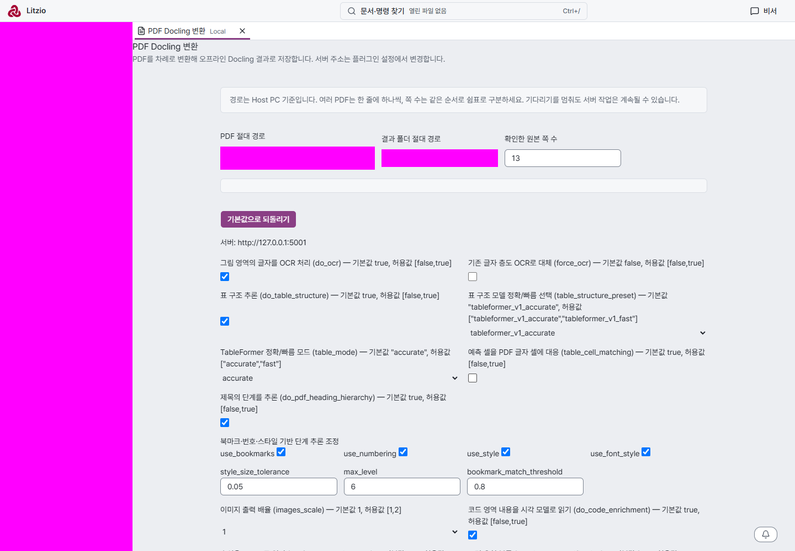
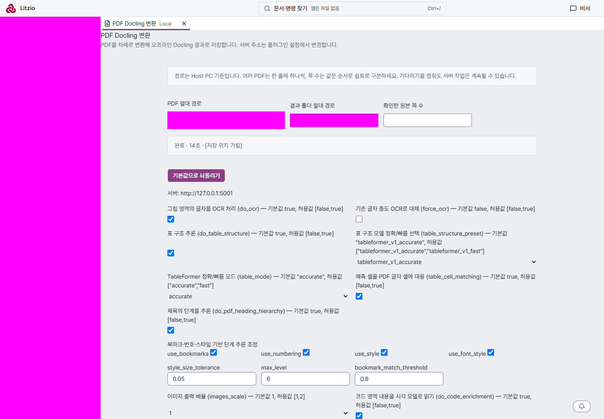

# docling-convert

PDF를 Docling 변환 서버로 보내 [변환 계약](../../contracts/docling-convert/README.md)의 결과 묶음을 받아 저장한다.

## 출처

이 폴더의 `host.mjs`, `screen.jsx`, `litzio-plugin.json`, `options.json`, `pdf-en-v2.json`은 리치오의 비서가 만든 것을 **고치지 않고 그대로** 넣은 것이다(2026-11-13, 비서의 플러그인 제작 시험의 과제 3: 변환 계약을 통째로 주고 만들게 함). 시험의 경위와 판정은 리치오 저장소의 `docs/reviews/plugin-screen-code-1592.md` "3단계" 절에 있다.

시험에서 확인된 상태:

- 첫 턴에는 완성하지 못했다. 한 번의 호출로 변환이 끝날 때까지 기다리게 만들었다가 호출 시간 제한에 걸렸고, 비서가 접수와 상태 조회로 나누는 구조로 고친 뒤 실제 서버에서 변환과 저장이 됐다(13쪽 표본, 약 46초).
- 계약의 일부가 빠져 있다(결과 이미지의 검증 등). 완전한 성공으로 판정하지 않았다.

계약에 맞춰 보완한 내용은 이 문서 아래에 날짜와 함께 구분해 적는다. 비서가 만든 원본은 이 커밋에 그대로 남아 있다.

## 보완 — 2026-11-13

원본은 커밋 `4791ca4`에 보존된다. 이번 변경은 기존 multipart → 접수 → poll → 결과 수령 구조와 옵션 정의를 유지한다. Host 진입점은 공개 제작 검사가 요구하는 리터럴 handler를 유지하고 `service.mjs`에 위임한다. `validation.mjs`는 서버 계약과 PNG 디코딩을 검사한다. 새 런타임 의존성은 없다.

### 계약 대조표 (원본 → 보완)

판정은 소스의 구현 여부이며 실제 검증 범위는 아래에 따로 적었다. 원본 근거는 `4791ca4:plugins/docling-convert/host.mjs`의 함수/식이다. 보완 근거는 이 폴더의 파일이다.

| 요구 | 원본 판정·근거 | 보완 판정·근거 |
| --- | --- | --- |
| 준비 확인 순서 | 부분: runConversion이 ready/version/OpenAPI/capabilities 수령만 함 | 충족: service.runConversion 순서 유지, validation.validateServer가 1.38.2·multipart 필드·preset 확인 |
| 한 PDF, MIME/basename, form 필드 형식 | 충족: FormData files, 배열 반복/객체 JSON/boolean 문자열 | 충족: 같은 조립 코드 유지, 가짜 HTTP에서 본문 검사 |
| 접수 즉시 응답, ID 인코딩, 1초 poll, result 수령 | 충족: convert/job와 encodeURIComponent | 충족: service.convert의 직렬 대기열, 동일 HTTP 흐름 |
| task/result success 및 errors=[] | 누락: complete=false 고정, 완전 성공 조건 없음 | 충족: runConversion의 complete 논리식 |
| 모든 쪽 존재 | 부분: allPages 계산하지만 성공 판정에 사용 안 함 | 충족: validateResult가 정확한 수·연속 키·page_no 확인 |
| 이미지 오프라인 해석 | 누락: URI 정규식만, image_decode_verified=false | 충족(지원 PNG 범위): PNG signature/CRC/zlib/scanline/filter 역변환; 다른 인코딩은 성공 거부 |
| 부분 성공·실패 기록 | 부분: HTTP 실패 기록, 입력 검증 실패는 작업 error만 | 충족: 후보 생성 뒤 옵션·원본 검증도 catch해 record에 진단; incomplete 이유 표시 |
| 1800초 전체 제한·HTTP 남은 시간 | 부분: timeout만 연결, dispose/화면 중단 없음 | 충족: 남은 시간 timeout과 AbortController 연결, stop/dispose가 로컬 대기 중단 |
| 중단은 서버 취소가 아님·uncertain 재전송 금지 | 부분: uncertain/recover 있으나 중단 UI 없음 | 충족: 명시 문구, 중단/불확실 실패 뒤 다음 제출 보류 |
| source.pdf/document.json/record 파일 | 충족: 후보에 3파일 | 충족: 같은 구성, 다음 플러그인 명령으로 검증 |
| 입력 basename/상대경로/bytes/digest | 충족: record.source | 충족: source.file=source.pdf 유지 |
| 프로필 전체/ID/hash·서버 package 버전·OpenAPI digest | 충족: record.profile/server/openapi_sha256 | 충족: 같은 필드, 실행 bytes hash와 LF profile hash 분리 |
| 실제 요청 전체·기본값 차이 | 충족: actual_request/overrides_from_default | 충족: 동일, 옵션 변경 실제 서버 확인 |
| task/status·UTC·elapsed·result body digest | 충족: record.task_id/task_status/result | 충족: 원본 필드와 task 응답도 함께 보관(고정 표본·소비자 호환) |
| document digest/schema/version/page_count | 충족: record.document | 충족: 그대로 유지 |
| 후보 완성 뒤 공개·덮어쓰기 금지 | 부분: rename 경로 있지만 complete=false라 도달 불가 | 충족: complete만 UUID 새 이름에 rename, 기존 결과 보존; OS rename 실패는 실패로 노출 |
| 조정값/고정값·타입·허용값·의존성 | 부분: 기본 검증 있으나 비활성 세부 옵션 조정 허용 | 충족: fixed/unknown 거부, 제목 범위, OCR·표 의존성, preset/mode 일치 검사 |
| 옵션 정의와 프로필 사본 일치 | 누락: 검사 없음 | 충족: test/service.test.mjs byte 대조 |
| 기본값 복원·옵션 설명/허용값/기본값 | 부분: 조정 UI 있으나 복원 없음 | 충족: screen.jsx, 고정값 별도 읽기 표시 |
| 여러 파일을 서버에 하나씩 | 누락: convert마다 동시 실행 | 충족: Promise 직렬 queue; 파일 경로/쪽 수를 같은 순서로 입력 |
| 진행·경과·완료 위치·재개방 | 부분: 화면 로컬 job ID에 의존 | 충족: Host 처리 모듈의 job 목록을 화면 mount부터 조회 |
| 공개 읽기 작업·비서 지침 | 부분: defaults/recover만 공개, 스킬 없음 | 충족: 공개 job, skills/convert/SKILL.md 등록 |

### 선택한 동작

옵션은 변환마다 기본 프로필을 복사하고 overrides를 적용한다. 설정의 전역 기본값을 바꾸지 않는다. 표 preset과 mode는 화면에서 함께 바뀐다. 잘못된 조합은 서버 제출 전에 거부한다. 실패 시 프로필 자동 하향·자동 재제출은 없다. 서버는 설정 `serverUrl`에서 받는다.

여러 PDF 경로는 한 줄에 하나, 확인한 쪽 수는 쉼표 구분이다. 공개 화면 계약에 열린 폴더/파일 목록을 받는 호출이 없어 경로 입력을 선택했다. 서버 취소 API는 없으며 기다리기를 멈추면 서버 작업이 계속될 수 있다. 이때 대기 중인 후속 파일은 자동 제출하지 않는다. 운영자가 기존 작업 상태를 확인한 뒤 명시적으로 플러그인을 다시 불러와 새 접수를 결정한다. 화면 닫기는 작업 중단이 아니다. Host 재시작·reload는 메모리 작업 목록을 복원하지 않는다. 보존된 후보 기록으로 recover 조회를 한다.

완전 성공은 변환 계약의 기계적 성공이며 의미 동등성·검수 완료를 뜻하지 않는다. 현재 디코더는 서버 표본의 non-interlaced 8-bit grayscale/RGB/gray-alpha/RGBA PNG만 허용하고, 다른 형식·인코딩은 불완전 결과로 보존한다. 디코딩 상한은 이미지당 256 MiB다. 내장 Node zlib로 압축 해제하고 scanline filter를 복원한다.

## 설치

공개 CLI의 폴더 설치가 동작한다. 별도 격리 Host를 명시한다. SDK/앱 내부 import나 다른 플러그인 코드 import는 없다.

```sh
node BUILT_CLI plugins install PLUGIN_DIRECTORY --host HOST_ORIGIN --json
node BUILT_CLI operation invoke local.docling-convert.job --input EMPTY_JSON --host HOST_ORIGIN --json
```

Host에서 읽을 수 있는 경로여야 한다. 이번 시험은 artifact를 격리 Host의 허용 root 안에 복사한 뒤 위 명령을 실행했다. 원본 폴더가 허용 root 밖에 있을 때는 artifact 검증 실패였다. 따라서 폴더 설치 자체는 플랫폼 부족으로 기록하지 않는다. 수정 후 install을 다시 실행해야 한다. PNG 캡처/입력 파일도 artifact digest에 영향을 주므로 입력 JSON은 artifact 밖에 둔다.

공개 `convert`는 write 작업이고 비서의 공개 도구는 read만 허용한다. 화면 또는 외부 CLI가 시작하고, 비서는 `job`과 `recover`로 관찰한다. write를 read로 잘못 선언하지 않는다. 플랫폼에 필요한 능력: 열린 폴더의 파일 선택/목록, 명시적 승인 아래 비서가 공개 write 작업을 실행하는 경로.

## 검사 결과 — 2026-11-13

- **가짜 HTTP/단위**: `node --test plugins/docling-convert/test/*.test.mjs`, 16개 통과. 사본 byte 일치, 실제 고정 PNG 디코딩·손상/누락 거부, multipart 형식·옵션, 성공/부분/오류/실패/접수 연결 끊김, 기록 필드, 새 이름 결과 보존, 지연 poll 중 로컬 중단과 후속 제출 보류. 1800초 실제 대기와 전원 장애는 시험하지 않았다.
- **실제 서버**: 기존 docling-serve 1.38.2 컨테이너를 compose `up -d --no-recreate --pull never`로 시작. ID 유지, ready 200. LSR-1.1 13쪽 권장값 약 27초, table_cell_matching=false 약 22초 모두 task/result success, errors=[], 모든 쪽·15개 이미지 디코딩 통과. 기본 결과 텍스트 155개 전부 고정 결과와 동일, 표 10/그림 2/그룹 2 동일. JSON byte 동등성·모든 bbox/셀의 전수 동등성·원문 의미 동등성은 주장하지 않는다. 변경 요청 전체와 차이가 record에 남았다.
- **리치오 화면**: 공개 master `c9cb271720c6`의 임시 사본을 빌드한 격리 HTTP Host. 원본 checkout tracked 파일은 변경하지 않았다. install/validate, 경로 입력→옵션 변경→접수→진행→저장 완료, 변환 중 탭 닫고 다시 열어 상태 유지 확인. 라이트 1440×1000에서 관찰. 초기 진입점 비리터럴과 격자 체크박스 늘어남을 수정했다. reload 중 artifact 변경 오류는 재설치 뒤 재개방으로 해소했다. 실제 AI 호출/설치된 앱/사용자 daemon은 사용하지 않았다.
- **다음 플러그인**: README의 `node src/generate.js BUNDLE OUTPUT BUILT_CLI`를 명령으로 실행. 새 묶음에서 generated-draft, generationMismatches=0, diagnostics=[] 확인. 초기 record.task 누락으로 생긴 partial-conversion 진단은 task 응답 보존 후 사라졌다. 그쪽 폴더는 수정하지 않았다. 초안은 미검수다.

캡처는 계정/경로를 가렸다. 소유자의 시각 승인은 별도다.

| 옵션 | 진행 중 | 완료 |
| --- | --- | --- |
|  |  |  |

미확인: 수백 쪽/스캔/다른 언어/다른 서버 버전, 동시 외부 사용자, 비정상 종료 복구, 1800초 경계·파일시스템 fault injection, PNG 외 형식, 실제 Desktop 패키지·원격 Host·소유자 시각 승인. 원본 쪽 수는 호출자가 확인하므로 잘못된 쪽 수 입력을 독립 PDF parser로 검출하지 않는다. UUID 이름과 rename을 쓰며 악의적 동시 파일시스템 변경/전원 장애의 원자성까지 보장하지 않는다.
